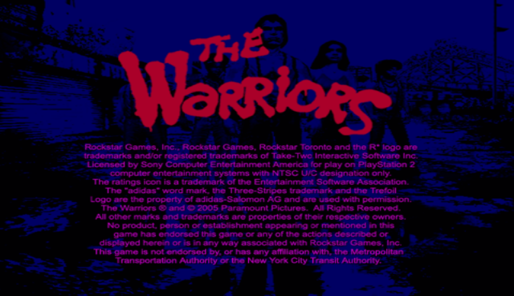
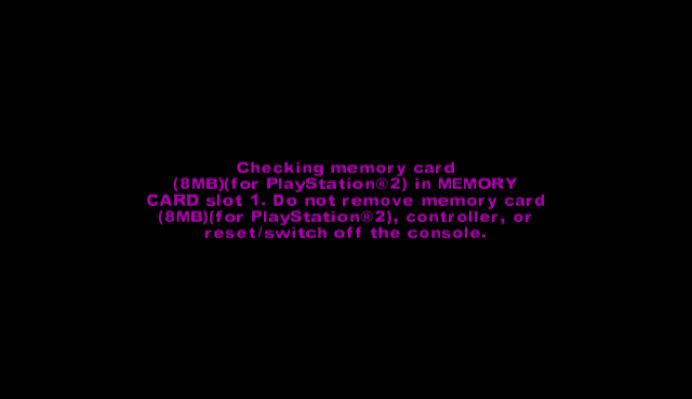
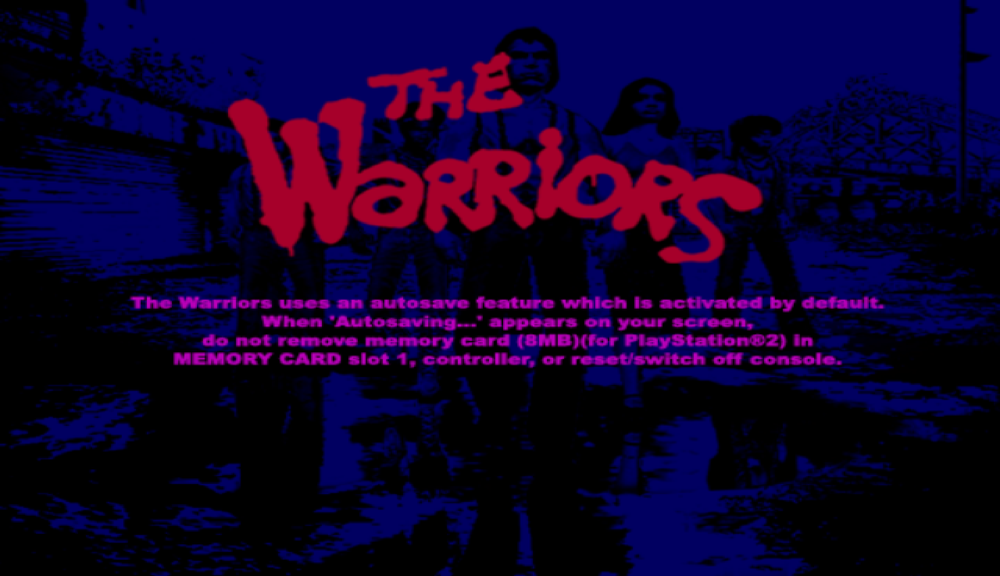
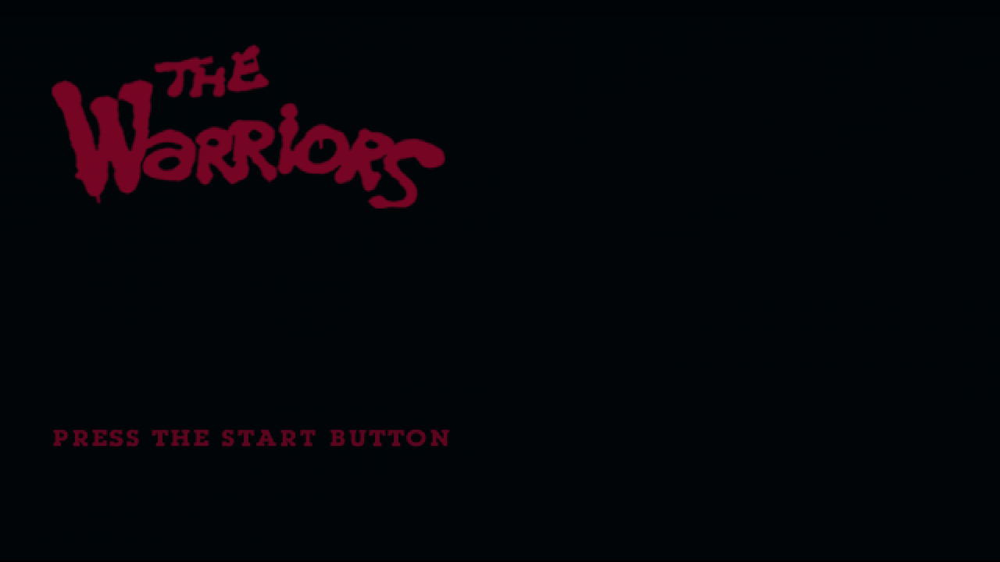

<div align="center">
  <h1>TW-Recomp</h1>
  <p><strong>The Warriors — Native PC Port via Static Recompilation</strong></p>
  <p>
    <a href="https://github.com/MateoEscobar/TW-Recomp/actions/workflows/build.yml"></a>
    
    
    
    
  </p>
</div>

# TW-Recomp — The Warriors on PC

A statically recompiled, native PC port of *The Warriors*
(PS2, USA, SLUS-21215), built on [PS2Recomp](https://github.com/ran-j/PS2Recomp).
The game's MIPS R5900 code is translated to C++ **at build time, from your own disc
image** — this repository contains no game code, assets, or media.

> This is not an emulator: the game's executable is recompiled into a native,
> portable binary with an OpenGL renderer. Ships with its own front-end
> (ImGui on SDL2, gamepad support) for Windows and Linux.

*The Warriors* (2005) is a beat 'em up / action game developed by Rockstar Leeds
and published by Rockstar Games, based on the 1979 cult classic film. It runs on
the **RenderWare 3.x** engine — the same engine used by GTA III, Vice City, and
San Andreas on PS2 — and uses **Sony MultiStream 7.1** for audio, running on the
PS2's I/O processor (IOP).

## Screenshots

**First boot screens rendered natively (2026-11-03, TWR-27).** The recompiled game now
boots from the legal screen to the title screen, at ~20–30 fps on the software renderer.
The game's own IOP modules run on the real IOP (no stubs).

| Legal screen | Memory card check |
|:---:|:---:|
|  |  |
| **Autosave notice** | **Title screen** |
|  |  |

> Work in progress:
> - The title screen is missing its animated neon *Wonder Wheel*: the 3D geometry reaches the GS
>   collapsed, so the 3D transform path is being worked on.
> - The colours of the legal and autosave screens are not verified against the PS2 yet.
> - There is no audio output yet (TWR-30).
> - Input past the title screen is the next milestone.

## Contents

- [For players](#for-players) — requirements, download & run
- [For developers](#for-developers) — build from source, project structure & docs
- [Progress](#progress) — what's done, what's next
- [Repository layout](#repository-layout)
- [Credits & license](#credits--license)

---

## For players

> **Note:** The project is in early development. There is no playable release yet.
> The game currently boots to its title screen (see [Screenshots](#screenshots)).
> This section will be updated when the first alpha build is available.

### Requirements (target)

|  | **Minimum** | **Recommended** |
|---|---|---|
| **OS** | Windows 10 64-bit · Linux | Windows 10/11 64-bit · Linux |
| **CPU (AMD)** | Ryzen 3 3200G | Ryzen 5 3600 |
| **CPU (Intel)** | Core i3-8100 | Core i5-10400 |
| **RAM** | 8 GB | 16 GB |
| **GPU (AMD)** | Radeon Vega 8 (iGPU) | Radeon RX 570 4 GB |
| **GPU (NVIDIA)** | GeForce GT 1030 (or Intel UHD 630) | GeForce GTX 1650 4 GB |
| **Graphics API** | OpenGL 3.3 | OpenGL 4.x |
| **Storage** | ~3 GB | ~4 GB |
| **Target** | 30 fps @ 1x | 60 fps @ 2x–3x |

- x86-64 CPU with **SSE4.1**.
- **Your own The Warriors USA disc dump (SLUS-21215).** Other regions are
  not supported at this stage. The front-end's install wizard will extract game
  files from your ISO on first run; no game data is distributed.

---

## For developers

### Engine notes

The Warriors uses **RenderWare 3.x** (Criterion Software), the same engine that
powers GTA III, Vice City, and San Andreas on PS2. The re3/reVC decompilation
projects are the primary reference for RenderWare internals on PS2:

- [re3](https://github.com/halpz/re3) — GTA III (PS2, RenderWare 3.4)

Audio is handled by **Sony MultiStream 7.1**. The EE talks to `MODULES/IOP.IRX` over
SIF RPC `0x12345`; it is *not* Miles Sound System, as early tickets assumed. The game's
original IRX modules (`SIO2MAN`, `PADMAN`, `LIBSD`, `IOP.IRX`, `MCMAN`, `MCSERV`) run
unmodified on the `ps2xIOP` R3000 interpreter from PS2Recomp. An SPU2 core is ported
from [god-of-war-recomp](https://github.com/KIexster/god-of-war-recomp), so music
already streams internally; routing it to the host's speakers is TWR-30.

VU1 microprograms (RenderWare's geometry pipeline) run on PS2Recomp's
cycle-exact VU1 interpreter. See [`docs/boot.md`](docs/boot.md) for every boot blocker
found so far, with its root cause and fix, and [`docs/iop.md`](docs/iop.md) for the IOP
integration.

### Build requirements

- Linux or Windows, x86-64 with SSE4.1
- CMake >= 3.21, Ninja, Python 3 (>= 3.10), Git
- 8 GB RAM minimum; 16 GB recommended for the unity build step

**Linux**:
```sh
# Debian / Ubuntu
sudo apt install build-essential cmake ninja-build git python3 \
    pkg-config libgl1-mesa-dev

# Arch
sudo pacman -S --needed base-devel cmake ninja git python
```

**Windows** — VS Build Tools 2022 (MSVC x64) + CMake + Ninja + Python 3.

### Build from source

The recompiled C++ sources are committed to the repo, so you only need to
compile — no need to run ps2xRecomp yourself unless you want to regenerate them.

```sh
git clone --recurse-submodules https://github.com/MateoEscobar/TW-Recomp.git
cd TW-Recomp

cmake -B build -G Ninja -DCMAKE_BUILD_TYPE=Release
cmake --build build --parallel

# Binary: build/ps2xRuntime/ps2EntryRunner
```

See [`docs/BUILD.md`](docs/BUILD.md) for the full guide, including how to
regenerate the recompiled sources from your own disc image.

### Run (developer preview)

```sh
# 1. Once: extract the whole disc next to the ELF (games/warriors/, ~4 GB, ignored by git)
python3 scripts/extract_iso.py "/path/to/Warriors, The (USA).iso" --all

# 2. Run from the repository root, using the software renderer
sed -i 's/^renderer = .*/renderer = "software"/' build/ps2xRuntime/savedata/settings.toml
./build/ps2xRuntime/ps2EntryRunner games/warriors/SLUS_212.15
```

The runtime resolves `cdrom0:` against the folder of the ELF, so `PS2X_CD_IMAGE` is not
needed. The OpenGL path is opt-in (`PS2X_GPU=1`) until it is validated against the
software renderer. Logs go to `logs/warriors.log` (or `PS2X_LOGFILE=<path>`).

---

## Progress

### Epic TWR-1 — Project Infrastructure

| Ticket | Description | Status |
|--------|-------------|--------|
| TWR-7  | Repo setup: root CMakeLists, CONTRIBUTING.md | ✅ Done |
| TWR-8  | PS2Recomp submodule + ps2xRuntime base | ✅ Done |
| TWR-9  | GitHub Actions CI/CD — Linux + Windows build matrix | ✅ Done |

### Epic TWR-2 — ELF Analysis & Recompilation

| Ticket | Description | Status |
|--------|-------------|--------|
| TWR-10 | Extract and verify ELF from ISO (SLUS_212.15, SHA256 verified) | ✅ Done |
| TWR-11 | ps2xAnalyzer → function map CSV, 122 SCE SDK stubs identified | ✅ Done |
| TWR-12 | ps2xRecomp → 16,262 C++ source files generated, build verified | 🔍 In review |
| TWR-13 | RenderWare + PS2 SDK stubs (sceXxx) | ✅ Done — superseded (its BT3-derived overrides were removed in TWR-27) |

### Epic TWR-3 — Graphics (RenderWare 3.x)

| Ticket | Description | Status |
|--------|-------------|--------|
| TWR-14 | OpenGL renderer for RenderWare 3.x | ⏳ Pending |
| TWR-15 | 16:9 widescreen patch | ⏳ Pending |
| TWR-16 | PSS/STR cutscene playback (FFmpeg) | ⏳ Pending |

### Epic TWR-4 — Audio, Input & Save

| Ticket | Description | Status |
|--------|-------------|--------|
| TWR-17 | Audio layer (originally scoped as Miles Sound System) | ✅ Done — superseded: audio is Sony MultiStream, see TWR-28 → TWR-31 |
| TWR-18 | DualShock 2 → SDL2 GameController | ✅ Done |
| TWR-19 | Memory card save/load → platform save dir (`%APPDATA%` / `~/.local/share`) | ✅ Done |

### Real IOP & clean boot (TWR-28 → TWR-31)

| Ticket | Description | Status |
|--------|-------------|--------|
| TWR-28 | Spike: run the game's IRX modules on `ps2xIOP` | ✅ Done |
| TWR-29 | Integrate `ps2xIOP` into the runtime (SIF load/bind/call, IOP→EE RPC) | ✅ Merged |
| TWR-27 | Clean boot with the real IOP — remove BT3 overrides, fix each blocker at its root cause | 🚧 In progress — boots to the title screen |
| TWR-30 | SPU2 audio output to the host | ⏳ Pending |
| TWR-31 | CD/WAD streaming + optional IOP ahead-of-time compilation | ⏳ Pending |

### Epic TWR-5 — Launcher & Distribution

| Ticket | Description | Status |
|--------|-------------|--------|
| TWR-20 | ImGui launcher + install wizard (ISO extraction) | ⏳ Pending |
| TWR-21 | Windows release build (.zip portable) | ⏳ Pending |
| TWR-22 | Linux release build (tar.gz, glibc 2.35) | ⏳ Pending |

### Epic TWR-6 — Patches, Extras & Mods

| Ticket | Description | Status |
|--------|-------------|--------|
| TWR-23 | 60fps patch | ⏳ Pending |
| TWR-24 | HD texture packs + mod loader | ⏳ Pending |
| TWR-25 | Local co-op 2 players | ⏳ Pending |

---

## Status & known issues

| Area | Status | Notes |
|---|---|---|
| Repo & CI/CD | ✅ Done | GitHub Actions: Linux + Windows (TWR-9) |
| ELF extraction | ✅ Done | SLUS_212.15 verified (TWR-10) |
| Function map | ✅ Done | 16,257 functions, 122 SCE stubs (TWR-11) |
| C++ recompilation | 🔍 In review | 16,262 files, build 2072/2072 passes (TWR-12) |
| IOP (real IRX modules) | ✅ Done | `ps2xIOP` interpreter, MultiStream answers RPC `0x12345` (TWR-29) |
| Boot | 🚧 In progress | Legal → memory card → autosave → title screen (TWR-27) |
| Rendering | 🚧 Partial | Software renderer draws the 2D boot screens correctly. 3D (title-screen Wonder Wheel) WIP; OpenGL path opt-in (TWR-14) |
| Audio (MultiStream + SPU2) | 🚧 Partial | Music streams inside the emulated IOP. No host output yet (TWR-30) |
| Input | ⏳ Next | HLE of the game's own `libpad` → SDL2 (TWR-27 / TWR-18) |
| Playable build | ⏳ Not yet | Next: main menu and a Rumble fight (TWR-27 DoD) |

**Known challenges:**

- RenderWare 3.x uses PS2-specific VU1 microcode for geometry transforms. It now
  runs on PS2Recomp's cycle-exact VU1 interpreter. Ahead-of-time compilation of those
  programs (as god-of-war-recomp does) is a later performance step.
- The runtime was bootstrapped from BT3-Recomp and still carries subsystems written
  for that game. They are being retired or fixed one by one, always compared against
  upstream PS2Recomp and god-of-war-recomp (inventory in [`docs/boot.md`](docs/boot.md)).
- The game has hardcoded 30fps logic in several gameplay systems. A 60fps patch
  requires identifying and patching timing constants (TWR-23).

---

## Repository layout

```
TW-Recomp/
├── CMakeLists.txt              # Root CMake — drives the full build
├── CONTRIBUTING.md
├── docs/
│   ├── BUILD.md                # Build guide + recompilation stats
│   ├── function-analysis.md    # ps2xAnalyzer output summary (TWR-11)
│   ├── boot.md                 # Boot blockers: symptom, root cause, fix (TWR-27)
│   ├── iop.md                  # Real IOP integration (ps2xIOP, TWR-29)
│   └── screenshots/            # Progress screenshots
├── games/
│   └── warriors/
│       ├── warriors.toml       # ps2xRecomp config (stubs, patches, I/O paths)
│       ├── patches/            # Game-specific ASM patches
│       ├── disc-info.txt       # Disc metadata (SLUS-21215, SHA256)
│       └── SLUS_212.15         # ELF — BYOD, ignored by git
├── mods/                       # Optional mod assets (not shipped)
├── ps2xRecomp/                 # MIPS→C++ recompiler (submodule: PS2Recomp)
├── ps2xRuntime/                # PC runtime: renderer, audio, input, front-end
│   ├── include/                # Runtime headers
│   └── src/
│       ├── lib/                # Core runtime (PS2Runtime, scheduler, IOP…)
│       ├── runner/             # Generated C++ sources (16,262 files — TWR-12)
│       ├── frontend/           # ImGui launcher / settings
│       └── gfx/                # Host graphics backend
├── ps2xAnalyzer/               # ELF analyzer (submodule)
├── scripts/
│   └── extract_iso.py          # Extracts SLUS_212.15 from your ISO
├── sonar-project.properties    # SonarQube config (sonar-cxx)
└── textures/                   # Optional HD texture packs (not shipped)
```

---

## Credits & license

- **PS2Recomp** by [ran-j](https://github.com/ran-j/PS2Recomp) — PS2 static recompiler,
  runtime, `ps2xIOP` interpreter and cycle-exact VU1. Licensed under MIT.
- **god-of-war-recomp** — SPU2 core and VU1 fixes ported into our PS2Recomp fork (GPLv3).
- **re3** by the re3 team — RenderWare PS2 reference implementation.
- *The Warriors* (2005) — © Rockstar Games / Rockstar Leeds. Game data is **not**
  distributed. You must supply your own legally obtained disc dump.

This project (tools, scripts, runtime code) is released under the **MIT License**.
See [LICENSE](LICENSE) for details.

---

> **BYOD — Bring Your Own Disc.** This repository contains no copyrighted game
> data. Any build of TW-Recomp requires the user to supply their own legally
> obtained disc image of *The Warriors* (NTSC-U/C, SLUS-21215).
